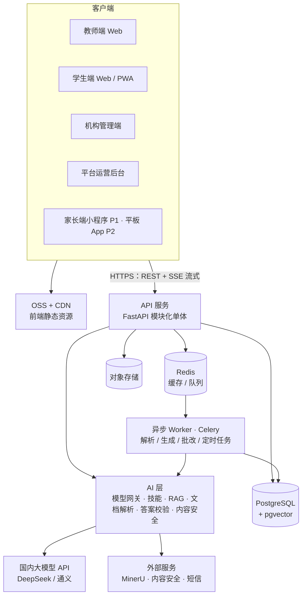

# AI 中小学智教平台 · 技术方案 v0.1

> 配套文档：[功能规划.md](功能规划.md)。本方案覆盖 MVP（P0），并为 P1、P2 留好扩展位置。整理日期：2026-11-01；2026-11-02 按已确定的决策更新（见第 14 节）。

## 0. 摘要

| 层 | 选型 |
|---|---|
| 前端 | React + TypeScript + Vite，Ant Design，TipTap 编辑器 |
| 后端 | Python 3.12 + FastAPI，模块化单体；Celery 异步任务 |
| 数据 | PostgreSQL（含 pgvector 向量检索、中文全文检索）＋ Redis ＋ 对象存储 |
| 大模型 | 国内已备案模型：DeepSeek＋通义（阿里云百炼），按技能分工、互为备用；自建轻量模型网关 |
| 文档解析 | MinerU（PDF / 图片转 Markdown＋公式）；多模态模型识别拍照作答 |
| 部署 | 阿里云：ECS、RDS PostgreSQL、Redis、OSS、CDN；先 Docker Compose，后上 K8s |

一句话：**一种后端语言、一个数据库、一个单体服务**，AI 能力全部封装在可替换的技能层里。小团队能快速迭代，模型和供应商随时能换。

---

## 1. 设计原则

1. **先单体，后拆分**。MVP 不做微服务，按业务模块分包，边界清楚，以后需要时再拆。
2. **能托管就托管**。数据库、缓存、存储、短信、内容安全都用云服务，团队精力放在业务和 AI 上。
3. **模型可替换**。业务代码不直接调用某家 SDK，统一走模型网关；每个技能单独配置用哪个模型。
4. **AI 结果默认要人确认**。出题、主观题批改都先进"待老师确认"状态，确认率达标后再逐步放开。
5. **安全链路不依赖单个大模型**。话题护栏、危机识别用"关键词＋分类模型"两路，任何一路命中就处理。
6. **数据留在境内，按机构隔离**。

---

## 2. 总体架构



- **同步请求**（页面数据、问一问流式对话）走 API 服务。
- **耗时任务**（资料解析、整篇教案生成、批量出题、批改、定时推送）进 Celery 队列，前端轮询或通过 SSE 收进度。
- **AI 层**和 API 在同一个代码库里，以 Python 包的形式存在，API 和 Worker 都可以调用。

---

## 3. 技术选型

### 3.1 前端

| 用途 | 选型 | 理由 |
|---|---|---|
| 框架 | React + TypeScript + Vite | 页面都在登录后，不需要 SEO；纯静态产物可以放 OSS＋CDN；以后用 Capacitor 直接打包成安卓平板 App |
| 路由 / 数据请求 | React Router、TanStack Query | 主流、文档多 |
| 组件库 | Ant Design 5 | 国内后台类产品的事实标准，表格、表单、看板组件齐全；学生端用同一套组件，换大字号、大触控区主题 |
| 文档编辑器 | TipTap（ProseMirror） | 类飞书文档体验：标题、表格、图片、公式；可以加"选中文字让 AI 改写"；文档存成 JSON |
| 公式 | KaTeX（显示）、MathLive（P1，公式输入键盘） | |
| 思维导图 | markmap | 直接把 Markdown 渲染成导图，和大模型输出格式天然匹配 |
| 图表 | ECharts | 学情报告、知识图谱可视化 |
| 接口类型 | 由后端 OpenAPI 自动生成 TS 客户端 | 前后端字段不会对不上 |

### 3.2 后端

| 用途 | 选型 | 理由 |
|---|---|---|
| 语言 / 框架 | Python 3.12 + FastAPI | 文档解析、向量检索、数学校验（SymPy）、各家模型 SDK 都在 Python 生态；只用一种后端语言 |
| ORM / 迁移 | SQLAlchemy 2 + Alembic | |
| 数据校验 | Pydantic v2 | 同时用来定义大模型的结构化输出 |
| 异步任务 | Celery + Redis | 成熟；自带定时任务（复习推送、周报） |
| 流式输出 | SSE | 问一问、教案生成边写边显示 |
| 认证 | JWT（短期 access＋长期 refresh） | |

### 3.3 数据与存储

| 用途 | 选型 | 说明 |
|---|---|---|
| 业务库 | PostgreSQL 16 | 阿里云 RDS 版 |
| 向量检索 | pgvector 扩展 | 和业务数据同库，按机构过滤方便，少一套系统 |
| 中文关键词检索 | zhparser 扩展 | 题库搜索、和向量检索混合召回 |
| 缓存 / 队列 / 限流 | Redis | |
| 文件 | 阿里云 OSS（本地开发用 MinIO） | 私有桶；前端用临时签名直传 |

### 3.4 AI 相关

| 用途 | 选型 | 说明 |
|---|---|---|
| 大模型 | DeepSeek＋阿里云百炼（通义），按技能分工、互为备用 | 两家都提供 OpenAI 兼容接口，网关层统一调用。长文生成和推理用 DeepSeek，结构化抽取、实时答疑、视觉用通义；具体路由见 `server/app/ai/gateway/models.yaml` |
| 向量模型 / 重排 | 通义 text-embedding-v4（1024 维）；通义 rerank 或自部署 bge-reranker | 每条向量记录模型名，换模型时可以重建 |
| 文档解析 | MinerU | 开源，中文和公式识别好；MVP 先用它的在线 API，量大后自部署（需要 GPU） |
| Office 文件 | LibreOffice 无界面模式转 PDF，再交给 MinerU | |
| 拍照作答识别 | 多模态大模型（通义 VL，当前用 qwen3-vl-plus） | 手写体识别＋判分一步完成 |
| 数学校验 | SymPy，在隔离子进程里运行，限时、断网 | |
| 间隔重复 | FSRS 算法（py-fsrs） | 比固定艾宾浩斯间隔更准，背诵卡片和错题复习共用 |
| 内容安全 | 阿里云内容安全（文本、图片）＋自建关键词库＋分类模型 | |
| 调用追踪 / 评测 | Langfuse（开源，自部署在境内） | 记录每次调用的 prompt、输出、耗时、费用；管理 prompt 版本和评测 |

**不建议**：
- 用 Dify、FastGPT 这类低代码平台做产品主体。它们适合教研同事快速试 prompt，但题库、作业、学情是正经的业务系统，最后还是要自己写。
- MVP 引入 LangChain 之类的重框架。P0 的技能都是一到三步的固定流程，直接写 Python 更好调试。P1 做 AI 助教时再考虑智能体框架。

---

## 4. 后端模块划分

| 模块 | 职责 | 阶段 |
|---|---|---|
| `iam` | 登录、账号、角色权限、租户上下文 | P0 |
| `org` | 机构、校区、班级、师生关系、批量导入 | P0 |
| `curriculum` | 学科、教材版本、章节、知识点树 | P0 |
| `content` | 资料文件、教案、讲义、背诵卡片、文档版本 | P0 |
| `qbank` | 题目、知识点标签、出题、校验、审核 | P0 |
| `assignment` | 布置任务、作答、判分、批改确认 | P0 |
| `learning` | 错题本、订正、复习调度、背诵记录 | P0 |
| `tutor` | 问一问会话、模式控制、上下文组装 | P0 |
| `safety` | 内容审核、话题护栏、危机预警工单 | P0 |
| `analytics` | 作业报告（P0）、掌握度、学情报告、周报（P1） | P0 / P1 |
| `notify` | 站内信、短信；P1 加微信服务通知 | P0 |
| `ops` | 租户开通、套餐额度、模型配置、用量统计 | P0 |
| `ai` | 模型网关、技能、RAG、解析、校验（被以上模块调用） | P0 |

模块之间只通过各自的 service 接口调用，不直接访问对方的表。

---

## 5. 核心数据模型

除平台公共内容外，所有业务表都带 `tenant_id`（机构 ID）。

| 分组 | 主要表 | 关键字段 / 说明 |
|---|---|---|
| 组织与账号 | `tenant`、`campus`、`klass`、`user`、`user_role`、`class_member`、`guardian_link` | 学生账号由机构批量创建（学号＋初始密码），不强制手机号；家长通过 `guardian_link` 绑定（P1） |
| 知识体系 | `subject`、`textbook_edition`、`chapter`（树）、`knowledge_point`（树）、`chapter_kp` | 平台维护公共树，机构可以挂自己的补充节点 |
| 内容 | `resource_file`、`document`、`document_version`、`doc_chunk`、`recite_card` | `document.type` 区分教案、讲义；正文存 TipTap JSON；`doc_chunk` 存切块文本＋向量＋知识点 ID |
| 题库 | `question`、`question_kp`、`question_check` | 题干、选项、答案、解析、难度、来源；状态：草稿 → 已校验 → 已审核；`question_check` 记录每次校验结果 |
| 作业 | `assignment`、`assignment_item`、`assignment_target`、`submission`、`answer` | `assignment.settings` 包含是否允许问 AI、答案公布时间等；`answer` 同时存 AI 分、置信度、老师最终分 |
| 学习 | `wrong_item`、`review_state`、`review_log` | 错题状态：待订正 → 已订正 → 已消除；`review_state` 存 FSRS 参数，卡片和错题共用 |
| 问一问 | `chat_session`、`chat_message` | 会话关联题目、讲义或作业，记录模式（学习 / 作业提示 / 订正）；消息带知识点标签和安全标记 |
| 安全 | `moderation_log`、`crisis_alert` | 危机工单有等级、状态、处理人、处理记录 |
| 运营 | `plan`、`quota`、`ai_usage`、`audit_log` | `ai_usage` 按机构、用户、技能、模型记录 token 和费用 |

---

## 6. AI 层设计

### 6.1 模型网关与路由

业务代码只说"我要调用哪个技能"，网关决定用哪个模型，并负责：
- 失败重试和切换备用模型
- 按机构、按用户限流和限额
- 记录 token、费用、耗时（写 `ai_usage`，同时上报 Langfuse）
- 去掉个人信息：学生姓名、手机号等不发给模型，用代号替换

任务和模型档位的对应关系（具体型号以上线时各家最新版本为准，写在配置里，不写死在代码里）：

| 任务类型 | 模型档位 | 例子 |
|---|---|---|
| 长文生成 | 通用旗舰模型 | 教案、讲义 |
| 结构化抽取 | 通用中档模型 | 背诵点、打知识点标签 |
| 理科解题、校验 | 推理模型 | 出题后独立求解、对答案 |
| 图片理解 | 多模态模型 | 拍照作答识别、主观题批改 |
| 实时答疑 | 低延迟中档模型＋流式 | 问一问（目标：首字 2 秒内出现） |
| 安全分类 | 小模型或云内容安全 | 话题护栏、危机识别 |

省钱手段：固定的系统提示和讲义上下文放在 prompt 前部，利用各家的上下文缓存；简单任务不用旗舰模型。

### 6.2 技能（P0）

每个技能是一个独立目录，包含：输入/输出结构（Pydantic）、prompt 模板（带版本号）、模型档位、检索策略、后处理与校验、评测集。

| 技能 | 输入 | 输出 | 要点 |
|---|---|---|---|
| 资料解析入库 | 上传的文件 | 文本切块＋向量＋知识点标签 | 异步；按标题层级切块；公式保留 LaTeX |
| 教案生成 | 课时、教材版本、选定资料、老师要求 | 教案文档 | 检索老师资料＋教材内容；流式输出 Markdown，前端转成编辑器文档 |
| 讲义 / 考点总结 | 同上 | 学生版讲义 | 语言面向学生；标出考点 |
| 背诵点抽取 | 讲义或教材片段 | 卡片列表（问 / 答 / 挖空） | 结构化输出 |
| 出题 | 知识点、难度、题型、数量、参考题 | 题目＋答案＋解析 | 结构化输出；随后自动走校验 |
| 答案校验 | 题目 | 一致 / 不一致＋理由 | 见 6.5 |
| 主观题批改 | 题目、参考答案、评分标准、作答（文字或图片） | 分数、扣分点、评语、置信度 | 低置信度的排在老师确认队列最前面 |
| 问一问 | 问题、上下文、模式、讲解风格 | 流式回答 | 见 6.6 |
| 错题订正引导 | 错题、学生作答 | 题目解析 → 考点分析 → 逐步讲解 → 思路总结 | 分步展示，学生可以随时停下自己做 |
| 安全分类 | 学生消息 | 是否学习相关、风险等级 | 见 6.6 |

### 6.3 RAG（检索增强）

- **数据来源**：机构上传资料、平台公共资料、题库，按 `tenant_id` 隔离；公共内容所有机构可见。
- **召回**：向量检索（pgvector）＋关键词检索（zhparser）两路合并，再用重排模型取前几条。
- **过滤**：先按学科、教材版本、章节、知识点缩小范围，再做语义检索，比全库检索准得多。
- **引用**：生成的教案、讲义标出处，老师能点回原资料核对。

### 6.4 文档解析流程

```
上传（前端直传 OSS）
  → Word / PPT 先用 LibreOffice 转 PDF
  → MinerU：PDF / 图片 → Markdown（含表格、LaTeX 公式、图片）
  → 按标题层级切块
  → 自动打知识点标签（结构化抽取技能）
  → 向量化，写入 doc_chunk
  → 通知前端"资料已就绪"
```

试卷拆题（P1）：同一条流程，最后一步换成"多模态模型＋规则切分成单题"，生成草稿题目，老师确认后入库。

### 6.5 出题与答案校验

```
出题技能生成题目（含答案、解析）
  → 推理模型在看不到答案的情况下独立求解
  → 有确定数值或表达式的题，用 SymPy 再算一遍
  → 两边一致：状态"已校验"，进入老师审核
  → 不一致：标红，附上分歧说明，老师重点看
  → 老师审核通过：入库，可以布置
```

老师每次的通过、修改、驳回都记录下来，用来统计各技能的"审核通过率"，也是改进 prompt 的依据。

### 6.6 问一问链路

```
学生发消息
  ├─ 并行：输入内容审核 ＋ 话题分类 ＋ 危机识别（关键词 + 分类模型）
  │     ├─ 危机高风险 → 进入危机流程（见下）
  │     └─ 非学习话题 → 礼貌拉回学习
  → 组装上下文：当前题目 / 讲义片段、学生最近错题、作业设置、讲解风格
  → 按模式选系统提示：
  │     · 学习模式：正常讲解，可以切换"讲简单点 / 举例子 / 编口诀"
  │     · 作业提示模式：只给思路和提示，不给最终答案
  │     · 订正模式：按四步引导
  → 模型流式输出
  → 输出审核；作业提示模式下再检查是否泄露答案，泄露则改写
  → 保存消息，打知识点标签（供问一问统计和学生画像使用）
```

老师在布置作业时关掉"允许问 AI"，作业期间学生端直接不显示入口。

**危机预警流程**：
1. 学生端立即显示安抚话术和求助电话（例如全国统一心理援助热线 12356、青少年服务台 12355；紧急情况提示拨打 110 / 120），对话不中断。号码做成配置，可以按地区调整，不让模型自己编。
2. 生成 `crisis_alert` 工单，按等级通知班主任（站内信＋短信），高风险同时短信通知家长。
3. 老师必须在后台确认处理并填写记录，超时未处理自动升级给机构管理员。
4. 识别规则宁可多报，不能漏报。评测时重点看召回率。

### 6.7 评测与可观测

- 每个技能配一份评测集（50–200 条，由教研同事维护），例如：出题看正确率，批改看和老师的分差，护栏看拦截率和误拦率，危机识别看召回率。
- 改 prompt 或换模型前必须跑评测，结果不低于上一版才能上线。
- 线上所有调用进 Langfuse，可以按技能、机构、模型看质量、耗时和费用。

---

## 7. 关键业务机制

| 机制 | 实现 |
|---|---|
| 客观题判分 | 提交时同步判分；填空题做规范化比较（全半角、空格、等价分数），数学表达式用 SymPy 判断是否等价 |
| 主观题批改 | 提交后进队列 → 批改技能给分 → 老师确认页按置信度从低到高排序，支持一键全部通过 |
| 错题本 | 判错或老师改为错的题自动进 `wrong_item`；订正对了标"已订正"；P1 加相似题，做对才"已消除" |
| 复习调度 | FSRS 根据每次作答的对错和用时算下次复习时间；每天由定时任务生成学生的"今日复习"清单 |
| 作业报告 | 提交时实时更新汇总表，报告页不做现场大查询；共性错题 = 错误率超过阈值的题 |
| 掌握度（P1） | 先用"按知识点、按时间衰减的加权正确率"，数据量够了再换 BKT / IRT 模型 |

---

## 8. 多租户、安全与合规

| 项 | 做法 |
|---|---|
| 租户隔离 | 应用层按 `tenant_id` 过滤，同时开启 PostgreSQL 行级安全（RLS），两层保护 |
| 权限 | 角色：平台运营、机构管理员、老师、学生、家长；接口按角色和班级关系校验 |
| 登录 | 老师、管理员用手机号＋短信验证码；学生用机构分配的账号密码；平板扫码登录放 P2 |
| 个人信息 | 手机号等字段加密存储；发给模型前去标识化；只收集必要信息 |
| 未成年人 | 监护人同意流程（机构线下收集或家长端确认）；数据保留和删除策略写进隐私政策 |
| 文件 | 私有桶，签名链接限时访问 |
| 审计 | 登录、导出、批量删除、修改成绩等操作写审计日志 |
| 合规配合 | 数据存境内；ICP 备案；生成式 AI 服务登记；进校的教育 APP 备案；等保 2.0 二级（不少学校采购会要求） |

---

## 9. 多端演进

| 阶段 | 端 | 做法 |
|---|---|---|
| P0 | 教师端、学生端、机构管理端、运营后台 | 同一个 Web 项目按角色分区（运营后台单独部署、单独域名）；学生端做成 PWA，平板浏览器可以"添加到桌面" |
| P1 | 家长端 | 微信小程序（推荐 Taro，可以写 React）；危机和周报通知走微信服务通知＋短信 |
| P2 | 学生平板 App | 用 Capacitor 把学生端打包成安卓 App，复用全部页面；配合安卓"锁定任务模式"或第三方 MDM 做管控；公布推荐机型清单 |

---

## 10. 部署与运维

| 阶段 | 方案 |
|---|---|
| MVP / 试点 | 阿里云：2 台 ECS 跑 Docker Compose（API、Worker、Langfuse），RDS PostgreSQL、云 Redis、OSS、CDN 用托管服务 |
| 规模化 | 迁到阿里云 ACK（K8s），API 和 Worker 分别按负载扩容；MinerU 自部署到 GPU 节点 |
| 环境 | 开发、测试、生产三套，生产数据不出生产环境 |
| CI/CD | GitHub Actions：跑测试、跑 AI 评测、构建镜像、部署 |
| 监控 | 阿里云 ARMS / SLS 看日志和性能，Langfuse 看大模型调用；关键告警发短信或钉钉 |
| 备份 | RDS 自动备份＋定期恢复演练 |

通义模型由阿里云百炼提供，和服务器可以用同一个阿里云账号、同一个企业实名；DeepSeek 单独开通、单独结算。

---

## 11. AI 成本估算

**以下为粗估，单价是假设值，上线后按 `ai_usage` 的真实数据校准。**

假设：
- 综合单价按 2–5 元 / 百万 token（国产中档模型的大致区间）
- 学生每个学习日：问一问约 10 轮，每轮约 4k token；批改约 5 张图，每张约 3k token；合计约 5.5 万 token
- 一年约 200 个学习日
- 老师每个工作日生成内容约 20 万 token（一年约 4,000 万 token，80–200 元），分摊到 50–100 个学生

| 项 | 每生每年 |
|---|---|
| 学生侧 | 约 1,100 万 token ≈ 22–55 元 |
| 老师侧分摊 | 约 1–4 元 |
| **合计** | **约 25–60 元** |

结论：AI 调用费在"每生 300 元"的目标成本里占比不大，但推理模型和图片批改的单价更高，一定要按技能做限额，防止个别用户刷量。

---

## 12. 代码仓库结构

```
ai4edu/
├─ apps/
│  ├─ web/            # Vite + React：教师端、学生端、机构管理端
│  └─ ops/            # 平台运营后台
├─ server/
│  ├─ app/
│  │  ├─ api/         # 路由层
│  │  ├─ core/        # 配置、认证、租户上下文、数据库
│  │  ├─ modules/     # iam、org、curriculum、content、qbank、assignment、
│  │  │               # learning、tutor、safety、analytics、notify、ops
│  │  ├─ ai/
│  │  │  ├─ gateway/  # 模型网关
│  │  │  ├─ skills/   # 每个技能一个目录：schema、prompt、校验
│  │  │  ├─ rag/
│  │  │  ├─ parsing/
│  │  │  └─ safety/
│  │  └─ workers/     # Celery 任务和定时任务
│  ├─ migrations/     # Alembic
│  └─ tests/
├─ evals/             # 各技能评测集和评测脚本
├─ deploy/            # docker-compose、Nginx 配置
├─ docs/
└─ refs/
```

前端用 pnpm 管理，后端用 uv 管理依赖。

---

## 13. MVP 里程碑

**假设团队**：前端 1 人、后端兼 AI 2 人、产品兼教研 1 人、设计半个人。照此估算，MVP 约 12 周。

| 阶段 | 周 | 交付 |
|---|---|---|
| M0 基础 | 1–2 | 仓库、CI、测试环境；账号、租户、班级、批量导入；模型网关＋Langfuse |
| M1 备课与题库 | 3–6 | 资料上传解析＋RAG；教案、讲义、背诵点生成＋文档编辑器＋导出 Word；出题＋校验＋审核入库 |
| M2 学生闭环 | 7–10 | 布置作业、学生作答、自动判分＋AI 批改确认；错题本与订正；背诵卡片＋FSRS；问一问（含护栏、作业模式、危机预警） |
| M3 收尾与试点 | 11–12 | 作业报告；运营后台（租户、用量、限额）；安全加固和压测；1–2 所种子学校或机构试点 |

**和开发并行的教研工作**（从第 1 周开始，否则会卡住 M1）：
- 整理初中数学、英语的知识点树（教材版本 → 章节 → 知识点）
- 准备各技能的评测集
- 收集种子用户的真实资料和试卷

---

## 14. 决策记录

| 决策 | 结论 | 状态 | 说明 |
|---|---|---|---|
| 主力模型 | DeepSeek＋通义（阿里云百炼），按技能分工、互为备用；不接入豆包 | 2026-11-02 确定 | 两家都已开通并充值。推理（deepseek-reasoner）和视觉（qwen3-vl-plus）目前各只有一个模型，没有备用 |
| 云厂商 | 阿里云 | 2026-11-02 确定 | ICP 备案跟着服务器走，在阿里云办；等保也按阿里云的方案做 |
| MVP 学科 | 初中数学＋英语，人教版 | 2026-11-02 确定 | 决定知识点树和评测集从哪里开始 |
| 后端语言 | Python | M0 已按此搭建 | |
| 代码托管 | GitHub 私有仓库 | 2026-11-02 确定 | CI 用 GitHub Actions |
